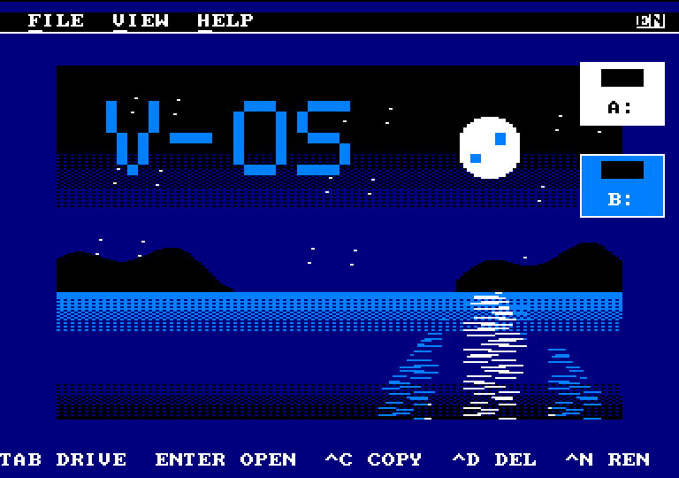
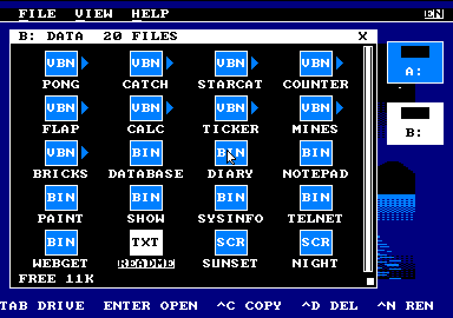
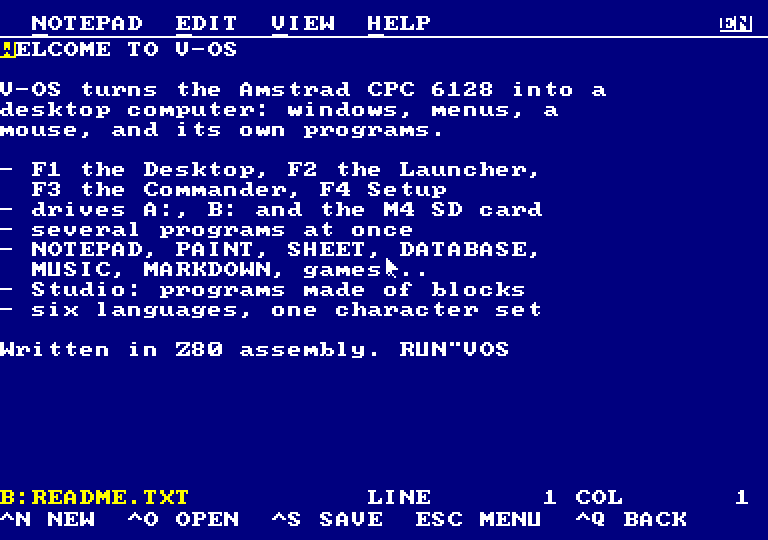
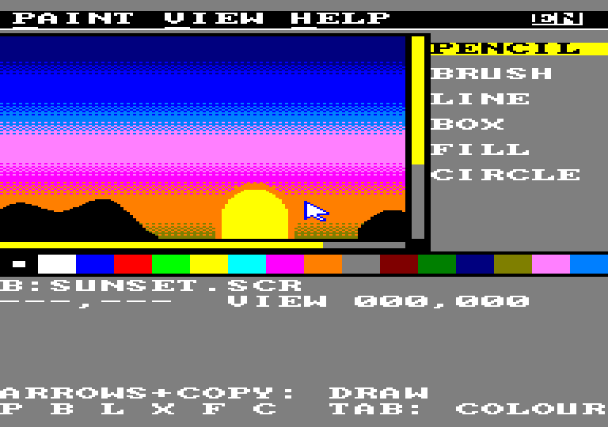
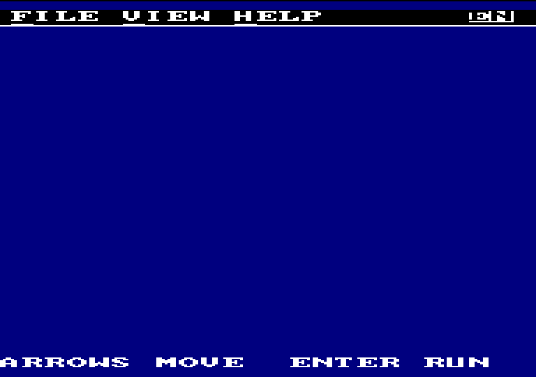
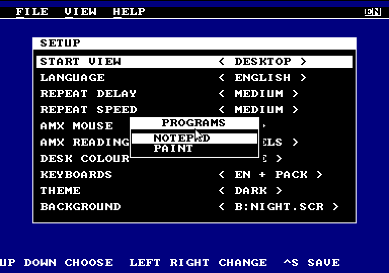

# V-OS

A graphical operating system for the Amstrad CPC 6128, written in Z80 assembly.

| | |
|---|---|
|  |  |
|  |  |
|  |  |

*In the dark theme, in English. More, and what V-OS does: [promo.md](promo.md).*

*Στα ελληνικά: [README.el.md](README.el.md).*

- **Documentation** (use, Studio, SDK, development), in Greek: [docs/manual/](docs/manual/00-index.md), and as a PDF in [docs/V-OS.pdf](docs/V-OS.pdf) (`make docs`)
- **Manual** in English, Français, Español, Deutsch, Italiano: [docs/manual/en/](docs/manual/en/00-index.md), [fr](docs/manual/fr/00-index.md), [es](docs/manual/es/00-index.md), [de](docs/manual/de/00-index.md), [it](docs/manual/it/00-index.md); PDFs: `docs/V-OS-<en|fr|es|de|it>.pdf`
- **Milestones**, with what was tested in each: [MILESTONES.md](MILESTONES.md)
- What is required and what has been decided: [docs/REQUIREMENTS.md](docs/REQUIREMENTS.md)
- Interface templates: [docs/interface-templates.html](docs/interface-templates.html)
- **On a real CPC:** what to try and how to report it, chapter 9 of the manual ([docs/manual/en/09-real-cpc.md](docs/manual/en/09-real-cpc.md))
- What may come next: [TODO.md](TODO.md)

## Build

You need [RASM](https://github.com/EdouardBERGE/rasm), [iDSK](https://github.com/cpcsdk/idsk), Python 3 and GNU make (4.3 or newer). For testing you need Caprice32 (snap).

```bash
make          # build/vos.dsk (A:) and build/apps.dsk (B:)
make run      # start in Caprice32 with RUN"VOS"
make shot     # start without a window and take a screenshot
make test-input  # key script with discs in A: and B:, screenshots in build/shots/<delay>
make test-calc   # the CALC calculator (mode 1) with clicks on the buttons, then CALC.VBS in Studio
make test-costume # a costume in Studio: draw, RUN, open again
make test-acc    # the CLOCK as a desk accessory, over the Launcher and Studio
make test-multi  # DEMO and PONG together: each one continues from where it was
make test-switch # F6: the list of running programs, and from the VIEW menu
make test-expand # with 512K expansion: STUDIO and CALC next to DEMO and PONG
make test-behind # IN BACKGROUND in Studio, and TICKER counting behind the Launcher and DEMO
make test-drag   # dragging: FILES, a dialog, the CLOCK and the CALC window
make test-mines  # MINES: click on each cell until a mine is found, then NEW
make test-bricks # BRICKS: the paddle moves, bricks break, GAME OVER, and SPACE for a new game
make test-vars   # the 128 variables and SAVE/LOAD VARS: VARS.VBS opens in Studio, changes and runs
make test-langs  # the LANGUAGE setting of Setup in all languages, and the Desktop and the keyboard in Italian
make test-lang   # English at start-up, Greek saved in Setup, then RUN"VOS" again
make test-amsdos # the same script, then AMSDOS in BASIC reads the V-OS files
make test-reboot # the same, then RUN"VOS" again with the SETUP.CFG that was saved
make test-system # the script with A: in SYSTEM format
make test-sdk    # the SDK template as TEMPLATE: opens from the Launcher, box, menu, ABOUT, BACK
make test-print  # NOTEPAD and SHEET print to Caprice32's printer file, checked; no printer: the error
make test-find   # FIND and SHOW THE TEXT in the Commander
make test-dcopy  # COPY THE DISC in the Commander: B: as A: after it
make test-saver  # the Desktop's screen saver (576K)
make test-show test-clock test-paint-undo  # SHOW, CLOCK's M4 time, PAINT's UNDO and CIRCLE (Z80)
make test-pic    # a .SCR shown by the Commander's SHOW THE TEXT
make test-keep   # KEEP THE DESKTOP: the window as it was after RUN"VOS again
make test-diary test-telnet  # DIARY and TELNET (Z80; TELNET with an M4 board in Python)
make test-diary-cap  # DIARY from A: in Caprice32, with DB.SYS: a note added and read back
make test-telnet-m4  # TELNET in the 1984 emulator, to a server on this PC
make release     # build/V-OS-<version>.zip: the discs, the PDFs, the pictures and the videos, for a GitHub Release
make docs        # the PDFs of the manual: docs/V-OS.pdf (Greek) and docs/V-OS-en/fr/es/de/it.pdf
```

Your own programs in assembly, with the V-OS API (guide and list of calls: [sdk/README.md](sdk/README.md)):

```bash
make new-app NAME=hello   # myapps/hello from the SDK template
make app NAME=hello       # build/HELLO.BIN, and into build/apps.dsk
```

Programs with blocks: open `blocks/editor.html` in a browser, make the program, save the `.vbp` and compile it:

```bash
python3 blocks/vbc.py pong.vbp --dsk build/vos.dsk
```

On the CPC: `RUN"VOS"` from the disc.

## Structure

```
src/vos.asm          root of the build: loader + kernel image, written to the DSK
src/boot/            loader that AMSDOS runs at #4000, RAM expansion detection
src/kernel/          vectors (#0000), kernel entry, interrupts, filesystem, ext.asm (kernel extension in bank 7)
src/drivers/         Gate Array, CRTC, keyboard, mouse, FDC
src/ui/              menus, buttons, focus, dialogs, file selection
src/shell/           shell views as overlays: Desktop (A), Launcher (B), Commander (C), Setup
src/api/vos_api.inc  the API for programs: addresses, events, keys, file format
apps/                programs for V-OS (apps/demo: the first, apps/mixed: the mixed screen, apps/studio: the blocks editor, apps/clock: the clock, the first desk accessory, apps/icons: their icons)
blocks/              programs with blocks: editor.html (Blockly), vbc.py (compiler), runtime.asm, player.asm (the Studio player, VBRUN.SYS on the disc), examples/
src/gfx/             overscan graphics, text, font (font_ascii.asm is generated)
src/include/         hardware ports, memory map
src/lang/            generated: message numbers, English texts and keyboard
lang/                language sources: en (base: ENGLISH.MSG and the kernel keyboard), el (GREEK.LNG), fr, es, de, it (FRENCH, SPANISH, GERMAN, ITALIAN.LNG), vos (the font of the V-OS character set, in every pack)
tools/               scripts: screenshot in Caprice32, mkfont.py, mklng.py, mktexts.py, mkicon.py, voscs.py (the V-OS character set), voscv.py (files to and from it), vdb.py (databases)
docs/                manual/ (the documentation, by chapter), V-OS.pdf, requirements, templates
sdk/                 the SDK for programs in assembly: guide, API, template/ (program template)
myapps/              your own programs (make new-app), which go into build/apps.dsk
```

Hex numbers in the code are written with `#` (e.g. `#C000`), because RASM reads `&` as AND.

## Status

V-OS is at **M72** (version 0.43 beta; each milestone adds 0.01). What each milestone added and how it was tested: [MILESTONES.md](MILESTONES.md).

## Licence

V-OS is free software under the [MIT licence](LICENSE), (C) 2026 Vassilis Perantzakis (Revive8bit). The 8×8 fonts come from Daniel Hepper's font8x8 (public domain); the blocks editor in the browser loads Blockly (Apache 2.0).
