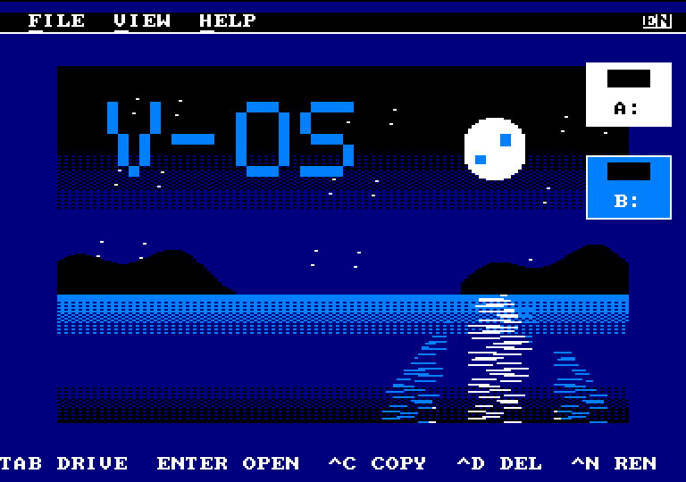
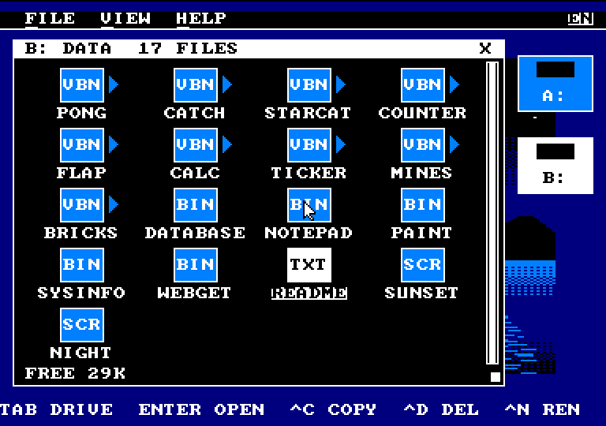
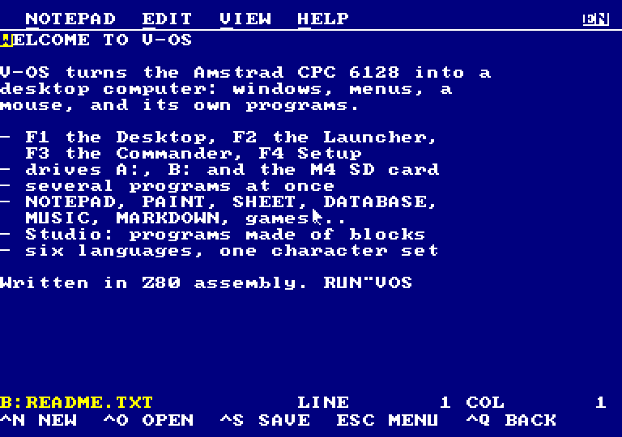
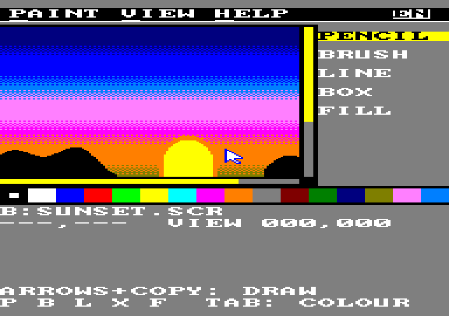
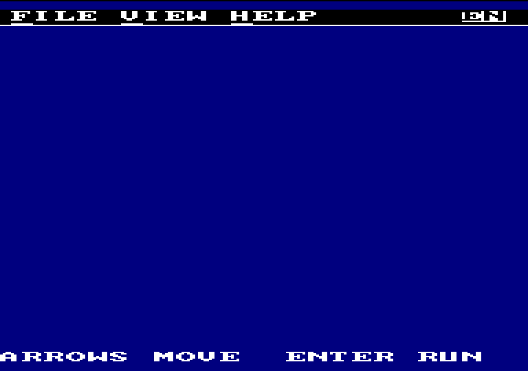
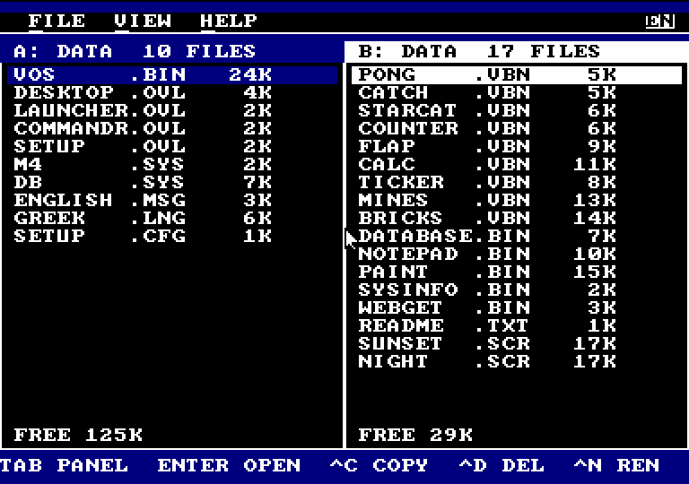
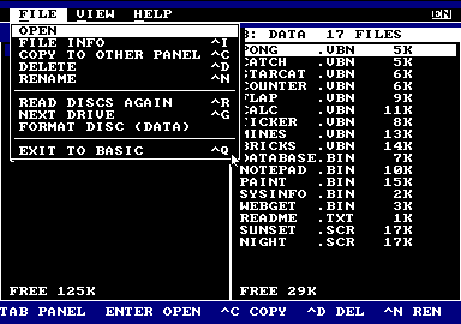
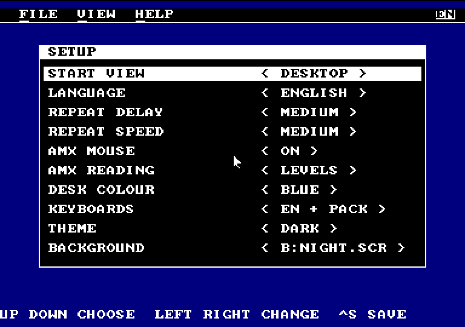
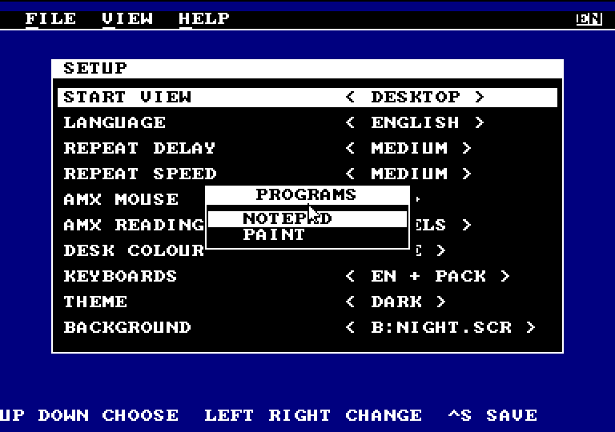

# V-OS — a graphical operating system for the Amstrad CPC 6128

V-OS turns a 1985 Amstrad CPC 6128 into a desktop computer with windows,
menus, a mouse and its own programs. It is written entirely in Z80
assembly, and it runs from a standard 3" disc. On the CPC: `RUN"VOS"`.

## The desktop

- **Four views**, a key each:
  - F1 the **Desktop**: file icons in a window you can move, resize and scroll;
  - F2 the **Launcher**: programs with their own icons;
  - F3 the **Commander**: two file panels side by side;
  - F4 **Setup**.
- **Menus, dialogs, buttons and file lists**, with the keyboard or with an AMX mouse.
- **A light or dark theme**, and a `.SCR` picture as the desk's background (with a memory expansion).
- **An overscan screen** of 384×272 in mode 1, mode 0 for colour and mode 2 for pages of text, and a mixed screen that shows two modes at once.

## Files and discs

- **Its own disc driver and file system**, compatible with AMSDOS: BASIC reads V-OS files and V-OS reads BASIC's. DATA and SYSTEM formats are both supported.
- **Drives A:, B: and the SD card of an M4 board** (DISK), with folders. Copy, delete, rename and open files on any of them, and programs can open and save files there too.
- **Files open by type:** a click on a `.TXT` opens NOTEPAD, a `.SCR` opens PAINT, a `.VDB` opens DATABASE.

## Many programs at once

- **Several programs run together**, each picking up where it was left, and the F6 switcher moves between them.
- **Programs keep running in the background**, for example the music while you work.
- **A desk accessory** (such as the clock) opens over any program.
- **A RAM expansion up to 576K** gives each program a 16K data bank of its own.

## Programs included

- **NOTEPAD:** texts up to 16K, a clipboard shared by all programs, and UTF-8 files from a PC.
- **MARKDOWN and READER:** Markdown pages from the disc or from the web, through the M4 board.
- **PAINT:** pictures with layers and the whole CPC screen, saved as `.SCR` files that BASIC loads too.
- **SHEET:** a spreadsheet with formulas (SUM, AVG, MIN, MAX, ROUND…).
- **DATABASE:** "a small Access" with tables, fields, indexes, forms and search, on discs or on the SD card.
- **MUSIC:** songs played from the interrupt, without a break while other programs load.
- **WEBGET:** downloads files from the internet with the M4 board.
- **SYSINFO, and games:** VROUVES (7 stages), MINES, BRICKS, PONG and more.

## Making programs

- **Studio:** programs made of blocks, Scratch style, right on the CPC, with sprites, costumes, music and 128 variables, saved as `.VBN` programs that run on their own.
- **A blocks editor in the browser** (Blockly), with a compiler for the same programs.
- **An SDK for Z80 assembly**, with a project template, a documented API of more than 40 calls and relocatable programs.
  - Calls include files, windows, dialogs, menus, sound and the clipboard.
  - There are also databases, formulas, UTF-8, the network and a routine that runs on every interrupt.

## Six languages

- **Greek, English, French, Spanish, German and Italian**, changed in Setup without a restart.
- **One character set for all six**, so languages can be mixed in the same text, with their keyboards a key away and sorting that ignores case and accents.
- **The manual is in all six languages**, as PDF too.

## Screenshots

In the dark theme, in English:

| | |
|---|---|
|  |  |
|  |  |
|  |  |
|  |  |
|  | |

---

*V-OS, by Revive8bit, 2026.*
